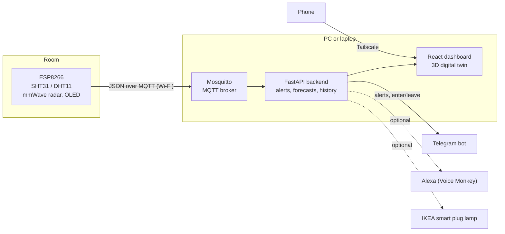

# Thαlpoς (Thalpos)

*θάλπος: warmth, comfort.*

Thalpos is a smart room monitor. An ESP8266 measures the temperature and humidity of a room, a mmWave radar notices when someone is there, and a FastAPI backend turns the readings into alerts, forecasts and advice. You follow it all on a 3D dashboard of your home and on Telegram.

**Optional wearable sleep integration:** import sleep stages from Android Health Connect, align room readings only with recorded sleep intervals, and review separate sleep and room scores plus how the room relates to your sleep across nights (sources cited in the app). Includes a private, authenticated local bridge, Android companion with opt-in background sync, and a responsive Sleep dashboard. Once paired, the bridge starts and stops with normal Thalpos. [Setup and privacy](docs/sleep-wearable.md).

**[▶ Live demo](https://xarismnt18-bot.github.io/thalpos/)**: the real dashboard with a simulated sensor, running in your browser. Nothing to install.

**[▶ Run the code in your browser](https://codespaces.new/xarismnt18-bot/thalpos?quickstart=1)**: opens the project in GitHub Codespaces and starts the whole stack (MQTT broker, a simulated board, the FastAPI backend and the dashboard). The dashboard opens by itself after about two minutes. Needs only a GitHub account.

[](https://codespaces.new/xarismnt18-bot/thalpos?quickstart=1)

**[📄 Presentation (PDF)](docs/Thalpos_presentation.pdf)**: the project in 16 slides, from the idea and the problem it solves to the hardware, architecture, code and lessons learned.


| Forecasts and recommendations | Telemetry charts | Phone |
|---|---|---|
|  |  |  |

<details>
<summary>The live dashboard in motion (humidity alert)</summary>


</details>

## What it does

- **Measures the room.** Temperature and humidity every few seconds (SHT31, or a DHT11 as fallback), shown on the sensor's own OLED screen and on the dashboard.
- **Knows when someone is in.** A 24 GHz mmWave radar detects people, even sitting still. Telegram tells you when someone comes in or the room becomes empty, reminds you to air the room after a long stay, and a hologram appears in the 3D room. Comfort alerts wait until someone is in, and the dashboard shows how long the room was used each day.
- **Warns you.** Too hot, too cold, too humid, mold risk, sensor offline or stuck: messages on Telegram, and optionally voice announcements on Alexa and a lamp that lights up.
- **Gives advice.** 10-minute forecasts, a health score, and whether opening the window will actually help, comparing the room with the weather outside.
- **Keeps history.** 30 days of readings in SQLite, charts, an alert log and CSV export.
- **Works from anywhere.** Installable on the phone and reachable securely over Tailscale, with no ports opened on the router.

## How it works



1. The **ESP8266** reads the sensors and publishes a small JSON message, for example
   `{"room": "Bedroom", "temperature": 23.4, "humidity": 51, "presence": true}`.
2. **Mosquitto** passes it to the **backend**, which validates and stores it and computes health, dew point, mold risk, forecasts and alerts.
3. The **dashboard** polls the backend and draws the house in 3D. The **Telegram bot** and the other notifiers run inside the backend.

The board finds the PC by itself: the backend broadcasts its address on the local network, so a new IP after a Wi-Fi change doesn't break anything.

## Hardware

| Part | Purpose | Connects to |
|------|---------|-------------|
| NodeMCU ESP8266 | Reads the sensors and sends over Wi-Fi | USB for power and the first upload |
| SHT31 breakout | Temperature and humidity (accurate) | I2C: SDA → D2, SCL → D1, 3V3, GND |
| DHT11 *(fallback)* | Temperature and humidity (cheap) | DATA → D4, 3V3, GND |
| 0.96" SSD1306 OLED | Shows the readings on the device | I2C: same SDA/SCL as the SHT31 |
| HMMD 24 GHz mmWave radar | Presence detection | OT1 → D5, 3V3, GND |

Everything runs on **3V3**; nothing goes to `Vin`. At start-up the firmware checks which parts are connected and uses what it finds. Wiring details, radar placement and flashing: **[docs/hardware.md](docs/hardware.md)**.

## Try it without hardware

- **Live demo**: the dashboard alone, with the sensor simulated in the browser.
- **Codespaces** (button above): the real backend too. `tools/simulate_board.py` publishes the same MQTT message the ESP8266 sends, so alerts, forecasts, presence and history all run for real. Logs are in `logs/`; `bash tools/codespaces_start.sh` restarts everything. Telegram, Alexa and the lamp stay off there.

## Quick start (Windows)

You need Python 3.11+, Node.js 18+, [Mosquitto](https://mosquitto.org/download/) and the Arduino IDE (its bundled `arduino-cli` is used for flashing).

1. **Install the dependencies**
   ```bash
   python -m venv venv
   venv\Scripts\pip install -r requirements.txt
   cd frontend-react && npm install
   ```
2. **Set up the sensor's secrets**: copy `firmware/esp8266_dht11/secrets.example.h` to `secrets.h` and fill in your Wi-Fi.
3. **Secure the broker** (once, asks for admin): `setup_security.bat` creates the MQTT passwords, adds the board's login to `secrets.h` and sets the firewall rules.
4. **Flash the sensor**: plug the board in by USB and run `flash_esp.bat`.
5. **Start everything**: `Run_Thalpos.bat`, then open http://localhost:5173.
   To start it automatically at every sign-in, run `install_autostart.bat` once.
6. **Alerts on your phone** (optional): `setup_telegram.bat`, then `setup_remote.bat` to open the dashboard over Tailscale.

## Which script do I run?

The scripts are in the project root and can be double-clicked. Each writes a `.log` file with the same name.

| Script | When |
|--------|------|
| `Run_Thalpos.bat` | Start broker, backend and dashboard in their own windows and open the dashboard |
| `create_shortcut.bat` | Once: a **Thalpos** icon on the desktop that does the same with a double-click |
| `install_autostart.bat` / `uninstall_autostart.bat` | Start Thalpos hidden at every Windows sign-in / undo it |
| `restart_thalpos.bat` | Restart the background instance (after a setup step or an update) |
| `flash_esp.bat` | Compile and upload the firmware over USB |
| `flash_ota.bat` | Upload the firmware over Wi-Fi (after the first USB upload) |
| `allow_ota.bat` | Once, to let Wi-Fi uploads through the firewall |
| `add_wifi.bat` | Teach the board the Wi-Fi network the laptop is on now |
| `serial_log.bat` | Restart the board over USB and save what it prints (troubleshooting) |
| `setup_security.bat` | MQTT passwords and firewall (once) |
| `setup_telegram.bat` | Telegram bot (once) |
| `setup_voice.bat` | Alexa announcements through Voice Monkey (optional) |
| `setup_ikea.bat` | Alert lamp on an IKEA smart plug (optional) |
| `setup_remote.bat` | Dashboard on the phone over Tailscale (optional) |
| `keep_awake.bat` | Keep a laptop server from sleeping while plugged in |
| `setup_backup.bat` | Once: weekly automatic backup of the history, sleep nights and settings (first one now) |
| `backup_data.bat` | Back up the data right now into `backups\` (set `BACKUP_DIR` in `.env` for a OneDrive folder) |
| `publish_demo.bat` | Rebuild the online demo on GitHub Pages |

## Repository map

```
├── firmware/esp8266_dht11/   ESP8266 sketch (secrets.h is git-ignored)
├── backend/                  FastAPI app, alerts, Telegram, Alexa, lamp, presence, history
├── ai/                       MQTT client, forecast, comfort and recommendation engines
├── frontend-react/           React + Vite dashboard (3D twin in src/components/immersive)
├── tests/                    pytest suite (no broker or accounts needed)
├── tools/                    Helpers the scripts call: flashing, serial log, Wi-Fi, setup, secret scanner
├── sensors/, reports/        Simulated data generator and a text report (ML demos)
├── docs/                     Documentation and screenshots
├── config.py, main.py        Backend configuration and entry point
└── *.bat                     The scripts in the table above (double-click them)
```

## Documentation

| Topic | What's inside |
|-------|---------------|
| [Hardware and firmware](docs/hardware.md) | Wiring, radar placement, flashing over USB and Wi-Fi, several Wi-Fi networks, troubleshooting |
| [Dashboard](docs/dashboard.md) | Pages, connection states, outside weather and window advice, history, phone install |
| [Notifications](docs/notifications.md) | Telegram alerts and commands, enter/leave messages, Alexa, alert lamp, quiet hours |
| [Running it at home](docs/running.md) | Autostart, remote access with Tailscale, a laptop as the server |
| [API and configuration](docs/reference.md) | REST endpoints, `.env` settings, how forecasts work, demo build, ML demos |
| [Security](docs/security.md) | MQTT login, local-only API, secrets, known limits |
| [Presentation (PDF)](docs/Thalpos_presentation.pdf) | The project in 16 slides: idea, problem, method, hardware, architecture, code, dashboard, lessons |

## Tests

```bash
venv\Scripts\pip install -r requirements-dev.txt
venv\Scripts\python -m pytest
```

The tests cover alerts, notifications, presence messages, voice limits, the alert lamp, Telegram commands, MQTT payloads and the API, without a broker or any account.

## Tech stack

C++ (Arduino, ESP8266) · MQTT (Mosquitto) · Python, FastAPI, paho-mqtt, SQLite, numpy · React, Vite, Three.js (react-three-fiber) · Telegram Bot API · Tailscale

## License

MIT

## Author

Built by **Charalampos Mentsios**.
[LinkedIn](https://www.linkedin.com/in/charalampos-mentsios/) · [GitHub](https://github.com/xarismnt18-bot)
